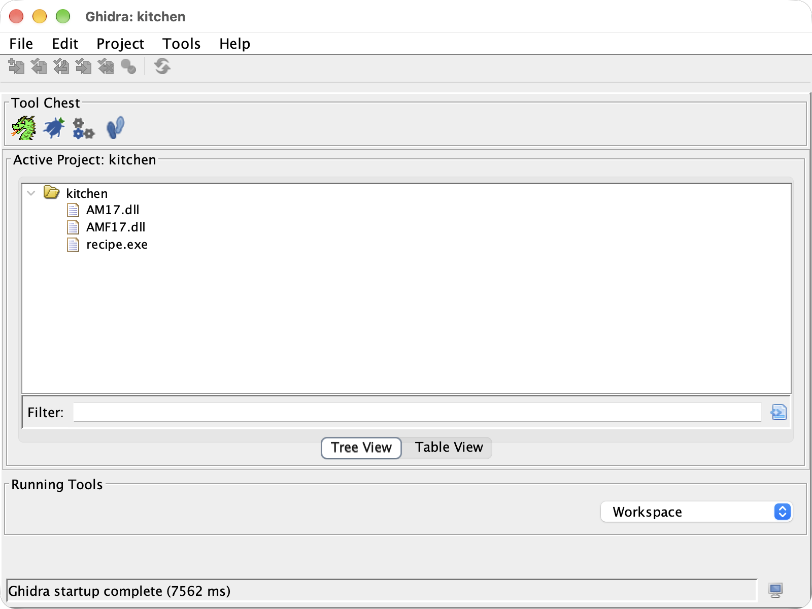
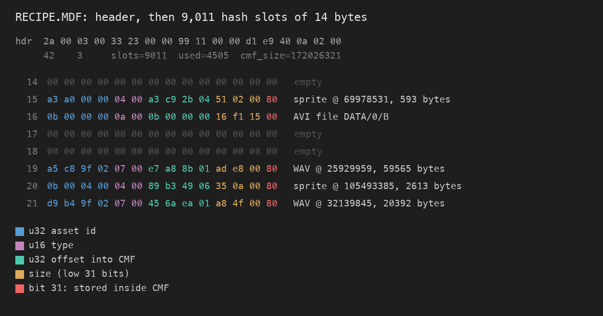
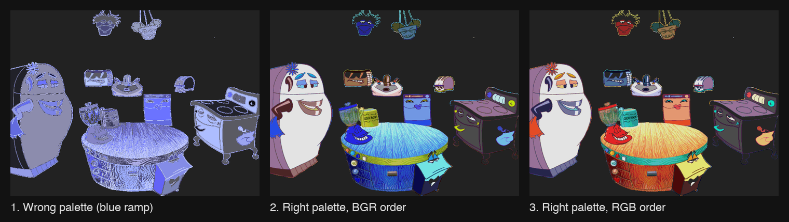
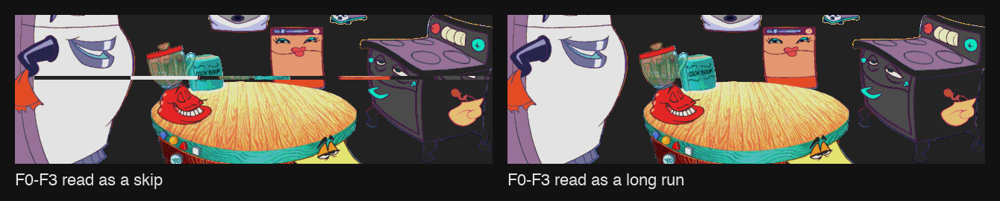

*Someone's in the Kitchen!* was one of my favorite games growing up. DreamWorks Interactive released it in 1996. You click around a cartoon kitchen full of talking appliances, and they sing, crack jokes, and walk you through recipes you can print out. It runs on Windows 95.

My household is Mac-only now. The PCs we do own run on ARM chips. The disc has sat in a jewel case for decades while every machine in the house drifted further from what it needs. When I finally ripped it to a CUE and BIN image, I had a working copy and nothing that could run it.

AI-assisted game preservation is a growing trend. Decompilation projects that once took a team years are getting faster as language models learn to read assembly and decompiler output. I wanted to see what that looks like on a game nobody has decompiled, using an AI coding agent as my pair. This post covers the first session.

## The Game in 1996

*Someone's in the Kitchen!* came out of a very particular moment. In March 1995, DreamWorks SKG and Microsoft announced a 50-50 game studio called DreamWorks Interactive, with offices in Redmond and Los Angeles. The new company aimed to have its first products in stores for Christmas 1996. This game was one of them. DreamWorks Interactive built it, and Microsoft published it.

The studio treated a children's CD-ROM like an animated production. The credits on MobyGames and IMDb list music and lyrics by Mark Henderson and Gregory Kuhn, voice direction by Andrea Romano, and a voice cast that includes Rob Paulsen, Tress MacNeille, Jeff Bennett, Mary Kay Bergman, and Ryan O'Donohue. Those names belong to the same voice actors who filled 1990s Saturday-morning cartoons.

A contemporary review in *Coming Soon Magazine* described the game as an activity center for children aged 4 to 7 and credited the concept to Steven Spielberg. The reviewer counted almost 300 clickable hotspots, more than 60 animated skits, and 28 original recipes that children could print and make in a real kitchen. Each printout included a character outline to color in. The cast included Mother Chill the refrigerator, Toby the Toaster, Blendolini the blender, Nuke the microwave, and Taste Test Four, the dog who eats every creation and reports his verdict by dancing or playing dead.

The disc's own readme sets the technical scene. The game required a Pentium 75, 8 MB of memory, a quad-speed CD-ROM drive, a 256-color display, and a Sound Blaster-compatible card. It warned that most sound cards could play only one sound at a time. It also reminded parents to skip Track 1 when playing the soundtrack on a stereo, because that track holds data and plays as loud static.

The studio's later history is a reminder of how fast the industry moved. The same DreamWorks Interactive created *Medal of Honor* in 1999. Electronic Arts bought the studio in 2000 and renamed it EA Los Angeles.

## The First Answer Was No

I gave the agent the two disc image files and asked it to decompile the game and recompile it for native Mac ARM. It did not start decompiling. It inspected the disc, identified the game, and told me the request was a months-long reverse-engineering project, not a single session.

Its reasoning held up. No tool turns a Windows 95 executable into ARM code automatically. A real port means decompiling the program by hand, decoding the game's data formats, rewriting the graphics, sound, and video layers for macOS, and only then compiling. The agent recommended Wine running under Rosetta 2 as the fast way to play the game today. It also warned that Apple plans to scale Rosetta back after macOS 27, so that route has an expiration date.

I chose the long route anyway. Playing the game was never the whole point. Preserving it was. The agent set up a Ghidra project.

## What Is on the Disc

The disc is a **mixed-mode CD**: one data track followed by fourteen standard audio tracks, so the soundtrack plays in any CD player. The agent extracted the data track by reading each raw 2,352-byte sector and keeping the 2,048 bytes of user data inside it. The result was a normal ISO with 63 files.

| File | What it turned out to be |
|---|---|
| `RECIPE.EXE` | The game. A 1 MB 32-bit Windows program written in C++ |
| `AM17.DLL`, `AMF17.DLL` | Microsoft AudioMan, a sound mixing library from the same era |
| `DATA/RECIPE.CMF` | A 172 MB archive holding nearly all art and sound |
| `DATA/RECIPE.MDF` | The index for that archive |
| `DATA/0/0` through `J` | Twenty ordinary AVI videos |
| `DATA/RECIPES/*.WMF` | Windows metafiles for the printable recipe cards |

## Setting Up Ghidra Without Touching the GUI

**Ghidra** is the NSA's open-source reverse-engineering suite. It disassembles machine code and decompiles it back into readable C. The agent drove it entirely from the command line. One headless call imported the three binaries and analyzed them. A short export script then wrote out every function's decompiled C, along with lists of imported Windows calls and embedded text.

Ghidra found 2,166 functions in the game executable and decompiled every one without a failure. It could name only 288 of them, mostly standard C runtime code it recognized from signatures. The other 1,878 are anonymous blocks with names like `FUN_0040cbb7`.

There was also bad news. MSVC can embed C++ class names in a program through **run-time type information** (RTTI), and reverse engineers lean on those names to map out a program's structure. This executable was built without it. Every class has to be identified by hand.

## Reading the Strings

Before reading any code, the agent mined the program's embedded text. The imports showed exactly which parts of Windows the port will have to replace: DirectDraw for the 640 by 480, 256-color display, MCI commands for CD audio and video, multimedia timers, and the AudioMan library. Error strings such as `ChefShowSprite: FindSpriteByName for %s failed` and `ChefGotoLayout: GetIView failed` described the engine in its own words. The game is built from layouts, views, and named sprites, and it talks to them through COM-style interfaces.

One string pointed at the registry key `HKLM\Software\DreamWorks Interactive\Cookin`. The code that reads it looks up a `Media` section with keys named `MDF1`, `CMF1`, and `Root1`. That told us the two big files in `DATA` were archive pairs, and where the game opens them.

## The Archive Index Is a Hash Table

The agent did not decompile the archive reader to learn the index format. It read the bytes. The fifth field of the MDF header was 172,026,321, the exact byte size of `RECIPE.CMF`. The third field was 9,011, a prime number. The rest of the file split cleanly into 14-byte records, and about half of them were all zeros.

A prime-sized table that is half empty is an **open-addressing hash table**. Each occupied slot holds an asset ID, a type, an offset into the CMF, and a size. The agent then checked the guess against the data instead of trusting it. It sorted the 4,485 entries that live inside the CMF by offset, and they tiled the 172 MB file end to end with zero gaps. That kind of check is what turns a hunch into a format.

The high bit of the size field was a flag. Entries with it cleared were the twenty AVI videos, stored outside the archive, and their "offset" was the video's file number in `DATA/0`. Everything else fell into three types: sounds, palettes, and images.

The sounds were the easy part. Every type 7 entry was a complete WAV file, 8-bit mono at 11,025 Hz. There are 3,045 of them across both archives.

## The Game Shipped Its Own Encoder

The images used compression the agent did not recognize. Searching the decompiled C for a flag value found in the image headers led to a surprise. The game contains its own sprite compressor, probably left over from the developers' build tools.

An encoder is a gift to a reverse engineer, because it states the format in the order it writes it. This one does four things:

1. It counts the distinct colors in the image and reserves index 0 for transparency.
2. It picks the smallest bit width that holds every color index.
3. It writes a small color map from those indices to the game palette.
4. It packs each row into bytes. A byte's high bits hold a color index, and its low bits hold a run length minus one.

With the encoder in hand, the agent wrote a decoder in Python. Full-screen animations use a second, larger scheme. For that one the agent read the game's decoder instead, a single function that Ghidra renders as roughly 9,700 lines of C, most of it hand-unrolled copy loops.

## Three Wrong Guesses

The first decoded images had the right shapes and the wrong colors. This stretch was the most instructive part of the session, because the agent was confidently wrong three times in a row.

1. **Which palette.** The archive holds two palettes. The agent used the first one it found, which turned out to be a smooth blue ramp. Every sprite had the right shape and a monochrome blue tint.
2. **Byte order.** The agent blamed the tint on byte order and flipped the palette to blue, green, red, as Windows bitmaps store colors. Every sprite turned red instead. Rendering the second palette in its original red, green, blue order produced correct colors.
3. **One opcode.** The agent read four opcodes in the full-screen scheme as "skip these pixels." One row of the main kitchen scene smeared a stripe across the whole screen. Re-reading the game's decoder showed those opcodes are long runs of a single color, with the color stored in the next word.

The pattern in all three was the same. The agent guessed from convention, rendered an image, looked at it, and corrected itself. It could not tell a right decode from a wrong one without rendering a picture and looking. The rendered image was the test suite.

A last group of 81 images then failed outright. Each one was exactly 307,200 bytes, which is 640 times 480. They were raw, uncompressed backgrounds, and handling them took three lines.

## Where Things Stand

| Asset | Count | Status |
|---|---|---|
| Image cels | 10,209 | Decoded, 0 failures |
| Sounds | 3,045 | Extracted as WAV |
| Videos | 20 | Standard AVI, playable as-is |
| CD audio tracks | 14 | Playable as-is |
| Functions in the executable | 2,166 | Decompiled, 1,878 still unnamed |

The tooling lives in a git repository: a headless Ghidra script, an export script, and a 150-line archive extractor. The game files and the decompiled output stay out of the repository. I own the disc. The assets and code belong to the original rights holders.

## What the AI Was Good At, and What It Was Not

The agent was fast at structure. It spotted the hash table from a prime number and a file size, and it confirmed the find with an arithmetic check I would not have thought to run. It read a 9,700-line decompiled function full of anonymous variables without losing its place. It never got bored, and boredom ends most hobby reverse-engineering projects.

It was weakest where it guessed. Each wrong guess came from a reasonable convention applied to a format that did not follow it. What saved it was checking: rendering an image, comparing totals, re-reading the original code. It also could not drive Ghidra's graphical interface. The automation tool on my Mac lacks Accessibility permission, so every Ghidra step ran headless.

The most useful moment came before any code ran. The agent told me plainly that my original request was out of reach in one sitting, and it offered the practical alternative. Then it did the long version when I asked for it.

## Next Time

The archives explain what the game looks and sounds like, but not how it behaves. Scene layouts, hotspots, and the scripts that drive the appliances are not in the CMF. The next suspect is a 5 MB file named `recipe.tdx`. After that comes the real port: an SDL application on Apple Silicon that loads these archives and draws the kitchen. [Part 2](/writing/2026-10-kitchen-decomp-part-2) covers both, and ends with the game running on an iPad.

## Sources

- [*Someone's in the Kitchen!* on MobyGames](https://www.mobygames.com/game/37069/someones-in-the-kitchen/) and its [credits page](https://www.mobygames.com/game/37069/someones-in-the-kitchen/credits/windows/)
- [*Someone's in the Kitchen!* full credits on IMDb](https://www.imdb.com/title/tt0220055/fullcredits)
- [Review in *Coming Soon Magazine*, issue 23](http://www.csoon.com/issue23/kitchen.htm)
- [TidBITS, "DreamWorks Interactive," March 27, 1995](https://tidbits.com/1995/03/27/dreamworks-interactive/)
- [GameSpot, "EA Buys DreamWorks Interactive"](https://gamespot.com/articles/ea-buys-dreamworks-interactive/1100-2541495/)
- [The Internet Archive's catalog entry](https://archive.org/details/someones-in-the-kitchen)
- The `Readme.txt` file on the original disc
