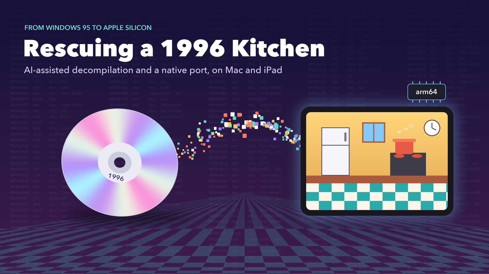
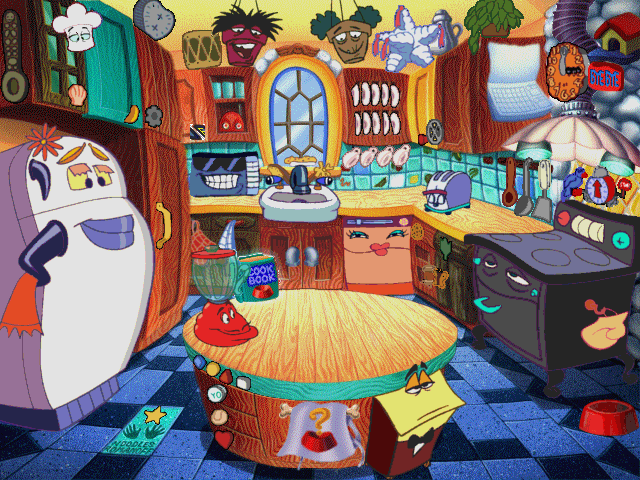
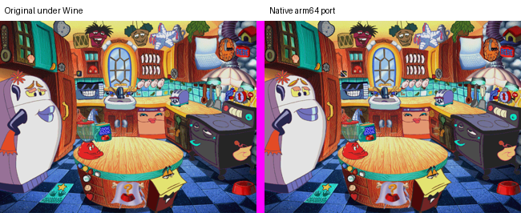
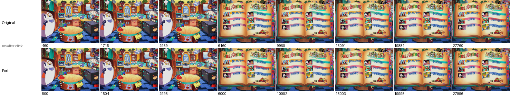
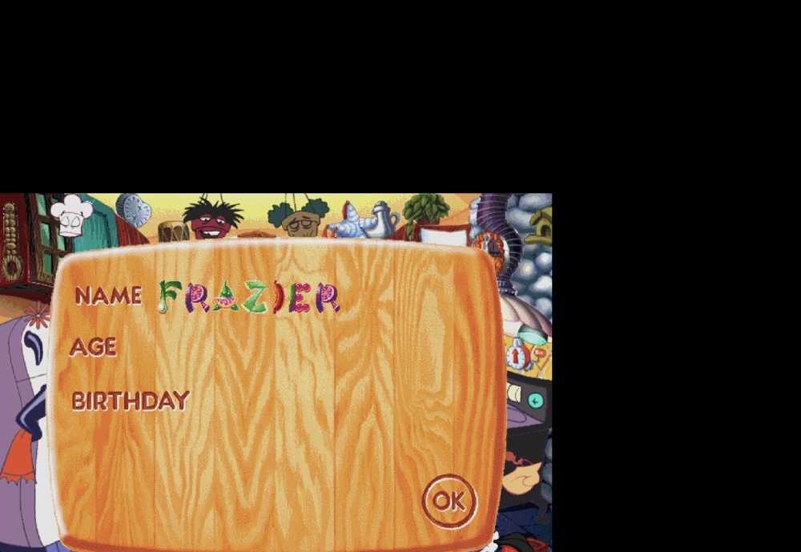

[Part 1](/writing/2026-10-kitchen-decomp-part-1) ended with every picture and sound from *Someone's in the Kitchen!* decoded and nothing that could play them. The archives describe what the game looks like. They say nothing about what happens when you click the refrigerator. This post covers the rest of the project: finding the game's logic, writing a native engine for Apple Silicon, checking that engine against the original, and finally running the game on an iPad.

## The Scene File

The next suspect was `recipe.tdx`, a 5 MB file in the `Setup` folder. The game opens it through a function that tries the bare name, then the `.TDX` extension, then `.TDF`, and finally falls back to an OLE compound document. The agent read the 12-byte header next. Its magic number was `0xF0F0`, and its counts and directory offset added up to the exact file size of 5,011,893 bytes. That arithmetic check was the same move that cracked the archive index in Part 1, and it worked again.

The directory is a tree of 841 entries: 209 scenes and 629 data streams. Each scene holds three streams.

| Stream | Contents |
|---|---|
| `ElemData` | Serialized COM objects, one per element. Each one names a sprite in the CMF archive, its animation segments, and its clickable regions. |
| `LyoElemInfo` | The starting position, depth, and visibility of each element. |
| `LyoActLists` | **Action lists**: what each element does when it is clicked or when one of its animations ends. |

More than 20,000 references in those streams point back into the archive. The kitchen had become a list of named elements, each with a position, a stack of animations, and a set of reactions.

## The Logic Is a Bytecode Machine

The reactions were the surprise. An action list does not contain game logic. It calls back into the executable with a number. A click on an element sends one number, and the end of an animation sends another. Something in `RECIPE.EXE` had to decide what those numbers meant.

Ghidra did not help at first. The functions behind error strings such as `ChefShowSprite` looked uncalled, because Ghidra had mangled their boundaries. The agent stopped trusting the decompiler and scanned the raw machine code for `call` instructions that targeted those addresses. The trail ended at a **bytecode interpreter**, a small virtual machine inside the game. Its program is `Setup/chef.stm`, a 1.3 MB file I had not opened yet.

The script holds 208 scenes. Each scene is a state machine with handlers for clicks, animation ends, and timers. The agent wrote a disassembler, and the result read like a design document. This fragment is the kitchen's handler for a click on the cookbook:

```
on click 64 @1184
    1184  goto_state 3
```

State 3 plays a short animation and, when it ends, moves to the cookbook scene. Every appliance, song, and joke in the game is wired the same way. The executable is an engine. The game itself is data plus 1.3 MB of bytecode.

That finding changed the project. A port no longer meant translating 2,166 functions of C++. It meant writing a new engine that loads the same data and runs the same bytecode.

## A Native Engine

The agent wrote the engine in C11 on top of SDL2, a cross-platform library for windows, input, and audio. Text uses Apple's CoreText, and printing uses CoreGraphics. The engine builds as a native arm64 program. It ships no game data. It reads my disc at run time, so the repository holds only new code.

The first run drew the kitchen and played its idle animations on their timers. Video followed. The twenty AVI files use two 1990s codecs, RLE8 and Microsoft Video 1. The agent wrote decoders for both and compared every sampled frame with the output of ffmpeg until the two were identical pixel for pixel.



## The Bug I Caught

The first bug report came from me, not the agent. The board where a player types their name was drawn as garbage. The agent tried two wrong fixes. One walked the rows in order and produced a convincing picture of the wrong thing.

The real cause sat in one byte. The second byte of each packed image header is a **shift**: row offsets are stored as 16-bit values shifted left by that amount. Large images use a shift of 2 so their offsets can reach past 64 KB. Every small sprite uses a shift of 0, which is why the decoder from Part 1 had worked on 10,209 images and still been wrong. Fixing it repaired the name board, the day panel, and the month panel in one change.

This bug is the clearest argument I have for keeping a person in the loop. The agent's checks all passed. Every image decoded without an error. Only a person looking at the screen could see that one class of image was nonsense.

## Splitting the Work Across Agents

With the engine running, I set a goal of full parity with the original. The agent split the remaining research across four sub-agents that ran in parallel, each reading the decompilation for one subsystem and writing a specification.

| Specification | Subject |
|---|---|
| Cookbook | Page layout, locked recipes, ingredient lists, and the hand-off that starts a recipe |
| Calendar | The month grid, holidays, birthdays, and a daily food fact |
| Audio and saving | The mixer, video sound, and the player file format |
| Sprite runtime | How animations advance, how depth is ordered, and how clicks are tested |

The calendar specification shows how much a 1996 children's game hid. The original computes fixed and floating United States holidays, Easter and the days that depend on it, and Hebrew-calendar holidays. It chooses a food fact for each day from a table of 63, indexed by the day number. Every table comes from my copy of `RECIPE.EXE` at run time.

The sprite specification was humbling. It found that the engine already in place had depth order backwards, applied each layout record to the wrong element, ignored which elements start visible, and stopped every animation after its first segment. The original plays an animation's whole path, including a 20-second hold that keeps the last frame and the sound running. The agent rebuilt the sprite runtime around the original's four primitives: Stop, SetPathSeg, SetPosition, and Start. The kitchen gained its whole cast of characters.

The audio specification settled a question from Part 1. The game never plays the fourteen CD audio tracks. Every multimedia call it makes opens a video. The tracks exist only for people who put the disc in a stereo.

The recipe cards print from Windows metafiles. The agent wrote a small metafile player that renders each card to PDF and sends it to the default printer without a dialog, as the original did.

A headless snapshot mode then let a script start all 208 scenes in turn. None crashed, none had a missing layout, and none used an unknown opcode.

## Wine as the Answer Key

A specification is a reading of code, and readings can be wrong. The only real test was the original game, running beside the port on the same input. Wine can run Windows programs on a Mac, but getting this one to start took several fixes. The installer's registry values had to be strings rather than numbers. They had to live in the 32-bit view of the registry, and the CD had to sit on a drive letter that Wine would not reassign.

The original then stopped at a warning that the display was not set to 256 colors. The agent found the single conditional jump that shows the warning and patched it in a copy of the executable inside the Wine folder. My original file stayed untouched.

Driving the original turned into three dead ends in a row.

1. **Screen recording.** macOS recorded only my desktop wallpaper. The game window sat on another Space, so the screen region was empty.
2. **Capture from a second program.** A helper program copied the game window into bitmaps. Every bitmap was one solid color, because Wine does not let one process read another process's window.
3. **Injected clicks.** The agent moved the helper inside the game process as an injected library. The captures worked, but every click vanished. The library had looked up the game's view window during the splash screen, before that window existed, and every click went to its parent.

There was a fourth trap. The original pauses itself when it loses focus, and a window on another Space never has focus. The fix was one message sent to the game before every action, telling it that it was active.

With those fixed, the same scripted session ran in both builds. The script typed a name and an age, picked a month and a day, and then clicked the refrigerator.



| Check | Original | Port |
|---|---|---|
| Sign-in boards | Same boards, same letter positions | Same |
| Refrigerator fade | About 1.0 s, starting 0.4 s after the click | About 1.0 s, starting 0.1 s after the click |
| Final refrigerator frame | Reference | 0.83% of pixels differ, all from idle animation timing |
| Cookbook contents page | Reference | 0.00% of pixels differ |
| Time until the cookbook page appears | 4.2 s | 5.2 s |



The oracle also caught real bugs. The port let the final sign-in summary board swallow clicks meant for the month and day panels beneath it, and the original lets those clicks through. The comparison also confirmed a quirk worth keeping. The original stores a player's age and the last month's calendar skit in the same byte, so the calendar quietly overwrites the age. The port does the same, because parity means matching the bugs too.

The cookbook timing is still open. The animation that plays before the cookbook lasts 4,416 ms according to its data, and the port honors that. The original starts its fade about a second early. I do not yet know why.

## Keeping the Agent Honest

I set the goal as "full parity" and attached a check that ran at the end of each of the agent's turns. Twice the agent wrote a summary that sounded finished. Twice the check pointed at its own checklist, where most areas were marked as implemented from a specification but never compared with the original. The agent went back to work both times.

This is the part of AI-assisted preservation I would stress to anyone trying it. The agent works quickly and writes confident summaries. A written checklist of what has been verified, and against what, is worth more than any summary. The checklist for this project lives in `notes/parity.md`, and it says plainly which behaviors still need the original.

## The Game on an iPad

The house runs on Macs and iPads, so I asked for an iPad build next. The engine needed almost no changes, because SDL2, CoreText, and CoreGraphics all exist on iOS. The new work was mostly around the edges.

| Area | Mac | iPad |
|---|---|---|
| Game data | Read from the disc folder | Copied into the app at build time, for my own iPad only |
| Saving | A shell command created the save folder | iOS has no shell, so the engine creates the folder itself |
| Printing | Straight to the default printer | The iPad print dialog, which can also save the page to Files |
| Input | Mouse | A tap counts as a click, and a trackpad still shows the hover cursors |

The build script compiles SDL2 for iOS, generates an Xcode project, converts the disc's own icon into an app icon, and installs the result over the network. Game data and the icon never enter the repository.

The first install crashed at once. My iPad runs iPadOS 27, which stops any app that does not use Apple's scene-based window lifecycle, and SDL2 predates that requirement. The agent found the cause in the crash report and added a small scene delegate that attaches SDL's window to the app's scene.

The second install ran, until I tapped the name field. The keyboard appeared, and the whole game shrank into the lower-left corner.



The game had been drawn 834 points wide, which is the iPad's width in portrait. SDL recomputes its view size when the keyboard appears, and it consults an orientation setting that no longer reports the truth once an app uses scenes. The agent patched SDL to take its size from the window scene instead. The patch lives in the repository and the build script applies it whenever SDL is downloaded. The next install worked, and the kitchen now runs full screen on an iPad Pro.

## What the AI Was Good At, and What It Was Not

| Strength | Example |
|---|---|
| Arithmetic checks on unknown formats | Header fields that summed to the exact file size, twice |
| Reading code that the decompiler mangled | Raw `call` scans that found the bytecode interpreter |
| Parallel research | Four specifications written at once from the same decompilation |
| Persistence through dead ends | Three failed capture methods before the oracle worked |

| Weakness | Example |
|---|---|
| Visual judgment | The garbled name board passed every automated check |
| Early summaries | Two "finished" reports that the parity check rejected |
| Assumptions from convention | A depth order that ran the wrong way until a specification corrected it |

The pattern from Part 1 held. The agent did its best work when it had something outside itself to check against: a file size, ffmpeg, a specification, or the original game running in Wine. It did its worst work when the only check was its own description of what it had done.

## Where Things Stand

| Area | Status |
|---|---|
| Archives, sprites, video, scene layouts | Verified against independent references |
| Script engine | All 208 scenes start with no unknown opcodes |
| Sign-in and the refrigerator transition | Verified against the original |
| Cookbook page | Pixel-identical to the original, with a one-second timing gap |
| Calendar, printing, audio, cursors | Implemented from specifications, not yet compared with the original |
| Platforms | Native on Apple Silicon Macs and on iPad |

The remaining parity items are the cookbook timing, two small click offsets in the calendar and player list, the drawing order of overlapping elements at equal depth, and the font of the cookbook's ingredient text. Each one now has a working method: script the same input into both builds and compare the frames.

Thirty years ago a DreamWorks team built this kitchen for children with Pentium 75s and 256-color monitors. The disc sat in its jewel case for most of that time. Today the kitchen sings again, on an iPad.
